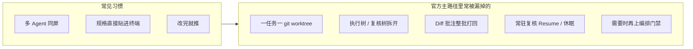
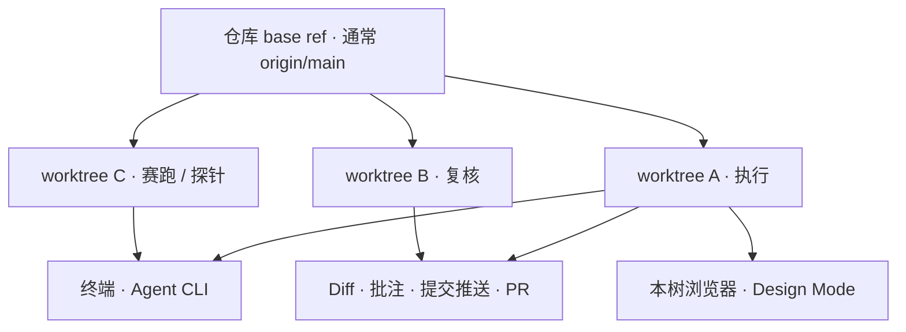
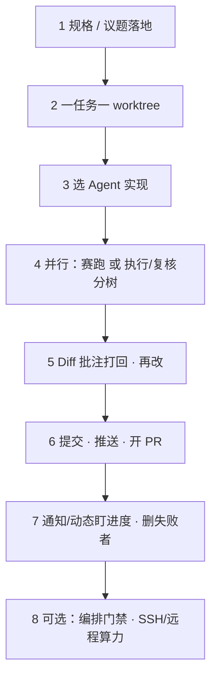

# Orca 特性手册 {#features-handbook}

专给已经会 **多 Agent 并行、把规格直接丢进树里落地**，但还没用上官方主推路径的人。本页只整理 [stablyai/orca](https://github.com/stablyai/orca) 文档与本站已有中文页里的真实能力——**不发明功能**。

> **怎么用本页**
> 1. 看清「高频 / 核心 / 官方推荐」三层，对上你少用的那一块。
> 2. 跟一条 **标准软件工程路径**（规格 → worktree → Agent → 审查 → PR）。
> 3. 下方互动看板点进深挖页；日常细则仍以 [快速手册](/docs/quick-guide) 为准，角色切入看 [按角色上手](/docs/roles)。

## 你已经在用 vs 官方还希望你用上 {#gap}

习惯没错——Orca 就是为并行 Agent 做的。缺口通常在：**隔离、审查闭环、会话复用**，而不是「再找一个新模型」。

## 全景：四条支柱 {#pillars}

| 支柱 | 含义 | 深挖 |
| --- | --- | --- |
| **隔离** | 每件事一块磁盘上的 git worktree，文件不互踩 | [Worktrees](/docs/model/worktrees) |
| **并行** | 同一 prompt 多分支，分屏盯，选出赢家 | [第一次三 Agent 会话](/docs/first-session) · [配方：赛跑](/docs/recipes/parallel-agents) |
| **审查** | 认真看 AI diff，行内批注打回 | [Diff 查看器](/docs/review/diff-viewer) · [批注](/docs/review/annotate-ai-diff) |
| **编排** | 要所有权、依赖、门禁时才上 Run / Task | [编排](/docs/cli/orchestration) · [技能](/docs/cli/skills) |

远程算力是可选层：[SSH](/docs/ssh)、[远程 Orca 服务器](/docs/remote-servers)、[运行方式](/docs/ways-to-run)。Orca **不卖** VPS。

## 高频特性（大家实际天天点） {#popular}

这些是上手后出现频率最高、也最容易「以为自己会了其实只会一半」的能力：

| 特性 | 一句话 | 深挖 |
| --- | --- | --- |
| Worktree 一任务一树 | 点仓库旁 **+**，真 `git worktree`，可一键删树带分支 | [Worktrees](/docs/model/worktrees) |
| 三 Agent 赛跑 | 同一 prompt、三条分支、分屏对照 | [第一次三 Agent 会话](/docs/first-session) · [配方](/docs/recipes/parallel-agents) |
| 标签 / 窗格 / 分屏 | 拖标签到边缘，同时盯多棵树 | [标签、窗格与分屏](/docs/model/tabs-panes-splits) |
| Diff + 行内批注 | `j`/`k` 换文件，`c` 留评论，**Send to agent** | [批注 AI Diff](/docs/review/annotate-ai-diff) · [配方：审 Diff](/docs/recipes/review-ai-diff) |
| 提交并推送 / 开 PR | 应用内交付，不必先切回外部 git GUI | [从 Orca 提交并推送](/docs/review/commit-push) |
| Cmd-J 跳转 | 在 worktree / 最近项之间跳；Shift-Enter 分屏开 | [快速打开](/docs/model/quick-open) · [跳转配方](/docs/recipes/jump-worktrees) |
| 本树浏览器 + Design Mode | 点元素，把 HTML/CSS/截图注入 Agent | [Design Mode](/docs/browser/design-mode) · [修 UI 配方](/docs/recipes/design-mode-fix) |
| 通知 · Agents 动态 | 完成 / 阻塞不用自己轮询终端 | [通知](/docs/notifications) · [Agents 动态](/docs/activity) |

## 核心特性（产品心智模型） {#core}

没有这些，多 Agent 只是「多个终端窗口」：

| 特性 | 为什么是核心 | 深挖 |
| --- | --- | --- |
| Agent 与会话生命周期 | 状态圆点、Restart 芯片、会话边界 | [Agent 与会话](/docs/model/agents-sessions) |
| 会话恢复 | 关窗口 ≠ 杀进程；布局与焦点可回来 | [会话恢复](/docs/model/session-restore) |
| Agent 休眠 | 空闲可暂停，回来 `resume` 同一会话（可恢复的 Agent） | [休眠](/docs/agents/hibernation) |
| 会话历史 | 从磁盘 transcript 找回过去会话 | [Agent 会话历史](/docs/agents/session-history) |
| orca.yaml / .worktreeinclude | 新树 setup、共享目录、忽略文件拷贝 | [orca.yaml](/docs/model/orca-yaml) |
| 支持的 Agent | Claude Code、Codex、Cursor CLI、GLM… 开箱列表 | [支持的 Agent](/docs/agents/supported) |
| 终端 | Ghostty 级体验：分屏、回滚、WebGL | [终端](/docs/terminal) |
| 归因 | 看清改动来自哪个 Agent | [归因](/docs/review/attribution) |

## 官方推荐做法（文档反复强调的） {#official-recommended}

不是新功能，是 **怎么把已有功能串成标准动作**：

1. **先走通最短路径** — [第一次三 Agent 会话](/docs/first-session)：加仓 → 开树 → 选 Agent → 赛跑 → 分屏 → diff → 发出去。
2. **执行与复核拆开** — 执行者一棵树、复核者另一棵（或同一树 Resume 换角色）；不要把「改」和「挡」塞进同一提示。[快速手册 §2](/docs/quick-guide#2-execute-plus-review)
3. **常驻复核，不要每次冷启动** — 固定 review worktree，用 Resume / 休眠，而不是每次 `+` 新树重喂规矩。[快速手册 §4](/docs/quick-guide#4-standing-codex-review)
4. **UI 是主路径** — 日常创建树、分屏、diff、提交都在窗口里；CLI / 编排给脚本化和门禁。[快速手册 §7](/docs/quick-guide#7-ui-is-the-main-path)
5. **编排按需** — 侧栏「编排技能 未安装」不等于不能派活；要 Run / Task / 依赖门再装技能。[编排](/docs/cli/orchestration) · [技能](/docs/cli/skills)
6. **议题进树** — Linear / Jira 可直接链到 worktree，规格有出处。[Linear](/docs/review/linear) · [Jira](/docs/review/jira)

## 标准软件工程路径：用 Orca 一步步做 {#se-workflow}

把「规格 → 实现 → 审查 → 合入」落到 Orca 的官方能力上（每一步都有手册页）：

| 步 | 你做什么 | 用到的 Orca 能力 | 深挖 |
| --- | --- | --- | --- |
| 1 | 规格写进议题或可引用的说明 | Linear / Jira → worktree，或任务名即规格摘要 | [Linear](/docs/review/linear) · [Jira](/docs/review/jira) |
| 2 | 从 base ref 开树；需要时配 setup | Worktrees · orca.yaml | [Worktrees](/docs/model/worktrees) · [orca.yaml](/docs/model/orca-yaml) |
| 3 | 在树内启动执行 Agent | 支持的 Agent · 终端 · Native Chat | [支持的 Agent](/docs/agents/supported) · [Native Chat](/docs/agents/native-chat) |
| 4 | 同题多模型，或执行/复核分树 | 赛跑配方 · 会话 / 休眠 | [配方：赛跑](/docs/recipes/parallel-agents) · [休眠](/docs/agents/hibernation) |
| 5 | 审 diff，意见整批打回 | Diff · 批注 · 归因 | [Diff](/docs/review/diff-viewer) · [批注](/docs/review/annotate-ai-diff) |
| 6 | 赢家树交付 | 提交并推送 · GitHub | [提交并推送](/docs/review/commit-push) · [GitHub](/docs/review/github) |
| 7 | 跨树盯完成/阻塞；清掉淘汰树 | 通知 · Agents 动态 · 删 worktree | [通知](/docs/notifications) · [动态](/docs/activity) |
| 8 | 门禁或远程算力（可选） | 编排 · SSH · 远程服务器 | [编排](/docs/cli/orchestration) · [SSH](/docs/ssh) |

> **和「只贴规格」的差别**
> 规格进树之后，还要有 **独立复核、批注闭环、可恢复会话**。否则多 Agent 只是加速产生未审查的 diff。

## 互动看板 {#board}

下方看板把「高频 / 核心 / 官方推荐」和「SE 八步」做成可点卡片，全部链到本站已有页。

## 下一步 {#next-steps}

- 还没跑通主路径：[第一次三 Agent 会话](/docs/first-session)
- 日常最高频 8 件事：[快速手册](/docs/quick-guide)
- 按岗位选入口：[按角色上手](/docs/roles)
- 安装与 CLI：[安装](/docs/install) · [命令使用](/docs/cli/commands)
