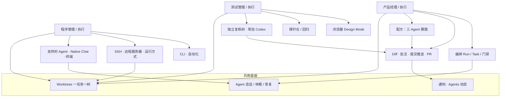

# 按角色上手 {#roles-onboarding}

Orca 面向已经以写代码为生、把 AI 当杠杆的人。不同岗位切入点不同——下面按 **产品经理/执行、测试管理/执行、程序管理/执行** 三条路径，只映射本站已有能力，不另造功能。

> **和其它入口的关系**
> [特性手册](/docs/features) 讲「高频 / 核心 / 官方推荐」与标准工程路径；[快速手册](/docs/quick-guide) 讲「每天最高频 8 件事」。本页讲「我是谁 → 先点哪几篇」。三者互补。

## 一张图：三条路径如何汇合 {#role-flow}

## 怎么选自己的列 {#how-to-pick}

| 你更常做的事 | 先看哪一列 | 15 分钟目标 |
| --- | --- | --- |
| 拆需求、并行试方案、盯 PR 合入 | 产品经理 / 执行 | 走完 [第一次三 Agent 会话](/docs/first-session) |
| 挡风险、审 AI diff、写探针/复现 | 测试管理 / 执行 | 用 [批注 AI Diff](/docs/review/annotate-ai-diff) 打回一条意见 |
| 在树里改代码、接远程算力、脚本化 | 程序管理 / 执行 | [安装](/docs/install) 后开一棵树跑通一个 Agent |

下方矩阵把每条路径钉到具体手册页。点卡片里的链接即可跳转。

## 三角色对照矩阵 {#role-matrix}

（见下方互动矩阵；与上图同一套真实文档链接。）
